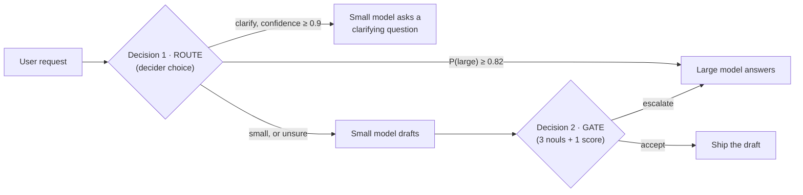
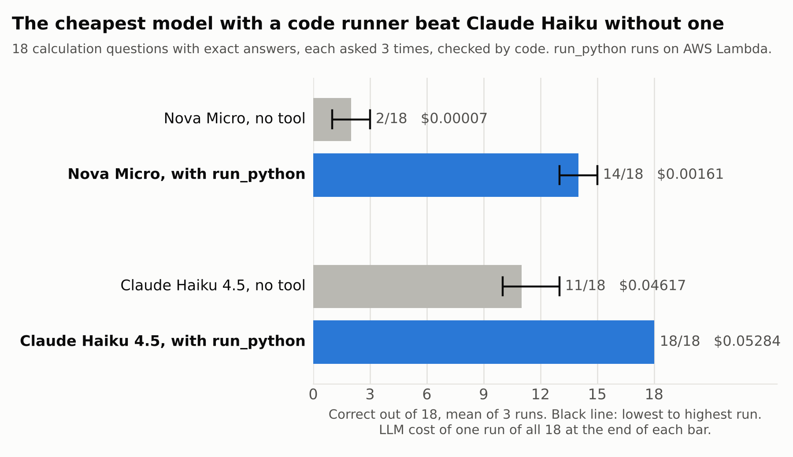

# Escalator

[](https://github.com/Swayam-Ch/escalator/actions/workflows/tests.yml)

**A Strands agent that only pays for a big Bedrock model when Strands Decider 2B says it has to.**

▶ **Demo video (under 3 min): https://youtu.be/PtXiIiXiwM4**

📝 **Builder Center article: [Escalator: let a 2B decision model decide when your agent needs the bigger LLM](https://builder.aws.com/post/3Kv1OQQQLOMoGHuLHIIp4OkN3O1_h/escalator-let-a-2b-decision-model-decide-when-your-agent-needs-the-bigger-llm)**

Most questions people ask an assistant are easy. Sending all of them to a large model is
like routing every support ticket to your principal engineer. Escalator puts a ~2B decision
model (Strands Decider 2B, running locally at no per-call cost) in front of two Bedrock
models and lets it make two calibrated decisions on every turn:



| Decision | Decider question type | Acts when | Otherwise |
| --- | --- | --- | --- |
| **Route**: which tier should answer? | `choice` over `small` / `large` / `clarify` | P(`large`) ≥ 0.82, or `clarify` with confidence ≥ 0.9 | cheap draft, then gate |
| **Gate**: is the small model's draft good enough? | `noul` × 3 (answers fully? hedging? high stakes?) + `score` (4-level rubric) | every check passes | escalate to the large model |

The model **classifies**, the code **decides**: each verdict is a number your `if` statements
branch on, so the policy is auditable and tunable, and the agent can't argue its way past it.
The default is safe: when the router is unsure, the cheap draft still has to pass the gate.

## The reusable decision pattern: *confidence-gated cascade*

[`escalator/patterns.py`](escalator/patterns.py) is self-contained (standard library only, no
Strands or Bedrock imports). Use it in any agent:

```python
from escalator.decider import Decider
from escalator.patterns import TierRouter, AdequacyGate, GatePolicy

decider = Decider()                                  # http://127.0.0.1:8099
route = TierRouter(decider, large_at=0.82).route(prompt)  # Verdict(action="small"|"large"|"clarify", ...)
if route.action == "small":
    draft = my_cheap_llm(prompt)
    verdict = AdequacyGate(decider, GatePolicy(min_quality=2.0)).check(prompt, draft)
    answer = draft if verdict.action == "accept" else my_expensive_llm(prompt)
```

[`examples/minimal_cascade.py`](examples/minimal_cascade.py) runs the pattern with plain Python
functions standing in for the two LLMs: no Strands, no Bedrock, no AWS account, just the decider.

Every `Verdict` carries `action`, a human-readable `reason`, the raw `signals` it branched on,
and the decider's `latency_ms`, which makes logging and threshold-tuning straightforward.

**Why it works with Decider 2B specifically:** the decider's confidences are calibrated (on
unseen short classification tasks, answers at ≥ 0.9 confidence are right ~95% of the time,
per the [strands-decider evaluation](https://github.com/strands-labs/strands-decider/blob/main/evaluation/results.md)).
An LLM's self-reported confidence gives you no such guarantee. Each decision is also a single
forward pass, with no generation and no API bill, so it can sit on the hot path of every request.

**Knobs** (all in code): `TierRouter.large_at`, `TierRouter.sure` and `TierRouter.expert_at`
(strict mode, off by default), plus `GatePolicy.min_answers`, `max_hedging`,
`max_high_stakes` and `min_quality`. Raise them to escalate more often (higher quality);
lower them to save more. `python bench/sweep.py <results.jsonl>` replays a saved benchmark
run at every router threshold, without new LLM calls, so you can choose `large_at` from data.

## Quick start

Requirements: Python 3.10+, AWS credentials with Bedrock access to the two models (default
`us.amazon.nova-micro-v1:0` and `us.anthropic.claude-sonnet-4-5-20250929-v1:0`, enable them in
the Bedrock console), and a machine that can run the 2B decider (CPU works; Apple silicon or a
GPU is faster).

```bash
git clone <this repo> && cd escalator
python -m venv .venv && source .venv/bin/activate
pip install -e ".[decider,dev]"
cp .env.example .env   # then edit; export the variables or use your AWS profile

# terminal 1: the decision model (downloads ~4 GB from Hugging Face on first run)
strands-decider serve StrandsAgents/strands-decider-2B-qwen3.5-v1-2610 --port 8099

# terminal 2: the agent
escalator                                   # interactive
escalator "What is the capital of Australia?"
```

Example trace (illustrative numbers; yours will differ):

```
decider route  -> small  (P(large) 0.28 < 0.82; small drafts, gate checks)  {...} 1800ms
decider gate   -> accept (draft is good enough)  {'answers': 0.93, 'hedging': 0.04, 'high_stakes': 0.16, 'quality': 2.3} 2000ms
  nova-micro-v1: 21+12 tok, $0.000002, 410ms

[nova-micro-v1] Canberra.
```

## Benchmark: measure the savings

```bash
python bench/run_bench.py            # cost + latency vs. always-large baseline (36 questions)
python bench/run_bench.py --judge    # + the large model grades every answer the small model shipped
python bench/run_bench.py --judge --questions bench/holdout.jsonl   # 24 questions never used for tuning
python bench/sweep.py bench/reported/v1-haiku-results.jsonl         # replay a run at every threshold
```

The set in [`bench/questions.jsonl`](bench/questions.jsonl) mixes easy, hard, ambiguous and
high-stakes requests. Results go to `bench/results/<timestamp>/summary.md`: total cost, median
and p95 latency, decider overhead, where each kind of question was routed, and (with `--judge`)
how many shipped small-model answers matched the large model's quality.

### Results

Nova Micro as the small model, Claude Haiku 4.5 as the large model and as the judge, with the
decider on an Apple-silicon MacBook (MPS). Full outputs are in [`bench/reported/`](bench/reported/).

| | v1: confident pick (≥ 0.9) | v2: P(large) ≥ 0.82 | v2 on held-out set |
| --- | ---: | ---: | ---: |
| Questions | 36 | 36 | 24 new, never used for tuning |
| LLM cost vs. always-Haiku | −68% | −20% | **−32%** |
| Small-model answers judged as good as Haiku's | 18 / 22 | 15 / 15 | 9 / 12 |
| Answers worse than the baseline | 4 of 33 | 0 of 33 | **3 of 23** |
| Easy questions answered by Nova Micro | 12 / 14 | 12 / 14 | 9 / 10 |
| Cost on those easy questions | −99% | −99% | **−99%** |
| Vague questions answered with a clarifying question | 3 / 4 | 3 / 4 | 1 / 3 |
| Decider time per question, median | 5.1 s | 3.8 s | 4.2 s |

**What v1 taught us.** All four v1 failures were code, SQL, schema design or a compound-interest
calculation that the gate let through. The gate's scores couldn't tell those drafts apart from
correct ones (every draft scored "answers" ≈ 0.90–0.95), because a 2B classifier can't check
code or maths. But the router's P(large) separated easy requests (0.17–0.47) from hard ones
(0.76–0.90). v1 ignored that signal because it waited for a 0.9-confidence pick that never came.
`bench/sweep.py` replayed v1 at every threshold, which showed the trade-off below; v2 uses 0.82.


| P(large) threshold | Saving | Answers worse than baseline |
| ---: | ---: | ---: |
| 0.90 | 68% | 4 |
| 0.86 | 43% | 2 |
| 0.83 | 40% | 1 |
| 0.81 | 30% | 0 |

**Read these numbers with care.**
- The saving comes from questions the small model can handle, and this set is half hard or
  high-stakes on purpose. A traffic mix with more easy questions would save more.
- The 0.82 threshold was chosen on the v2 set. On the held-out set, 3 of 23 answers came out
  worse (see below). So 0 of 33 on the v2 set was optimistic.
- Haiku grades its own reference answers.
- The large model was Claude Haiku 4.5, a generation behind today's Claude models. Both models
  are set by environment variables (`ESCALATOR_SMALL_MODEL`, `ESCALATOR_LARGE_MODEL`); I haven't
  measured the current generation yet.
- Laptop latency is not the decider's best case. Its published median is about 115 ms per
  question on an RTX 3090.

**What the held-out set showed.** The saving held up (−32%, in line with the sweep's
prediction of about 30%), but quality didn't hold perfectly. Three cheap answers were judged
worse than Haiku's:
- a Python bracket-matching function: code again, routed just under the threshold;
- a US home-office tax question: the gate didn't flag it as high-stakes;
- a one-line sentence rewrite. Checked by hand, Nova's answer ("We can't proceed with the request
  now.") is fine; the judge marked it down because Haiku's own answer also offered a shorter
  version. So 2 of the 3 are real failures.

Two of the three repeat v1's lesson: a 2B classifier can say whether code or advice *looks*
complete, not whether it's right.

**v3: a rule for code and advice, tested on a second held-out set.** v3 adds one yes/no question
to the router's decider call: does the request ask for code, a multi-step calculation, or advice
on tax, law, medicine or money? If P ≥ 0.5, the large model answers directly. Because that rule
was designed after seeing the first held-out set, I compared v2 and v3 on 24 more questions that
neither had seen ([`bench/holdout2.jsonl`](bench/holdout2.jsonl)):

| Second held-out set (24 new questions) | v2 | v3 (strict mode) |
| --- | ---: | ---: |
| LLM cost vs. always-Haiku | **−36%** | −11% |
| Answers worse than the baseline | **0 of 23** | 0 of 23 |
| Answered by Nova Micro and judged as good | 12 / 12 | 9 / 9 |

v2 made no mistakes on this set, so v3 had nothing to catch. It sent five more questions to
Haiku: a JavaScript debounce function and a SQL query that Nova Micro had answered correctly,
two that v2 escalated anyway, and "What is 15% of 200?" at P = 0.51. The question itself
separates well (easy questions scored 0.04 to 0.12 apart from that one; hard and high-stakes
ones mostly 0.6 to 0.86), but on this evidence it costs 25 points of savings for no measured
gain. **v2 stays the default.** v3 is available as strict mode (`TierRouter(expert_at=0.5)`,
`--strict` on the CLI and benchmark) for products where one wrong answer about code or money
costs more than the savings.

Across both held-out sets (48 questions), v2 saved 34% with 2 real failures in 46 answers.

Next steps, not yet measured: one of the larger Gemma 4 deciders, which score better on the
decider's own benchmarks, and a held-out set large enough to tune on without overfitting.

Prices live in [`escalator/pricing.py`](escalator/pricing.py). Check them against the
[Bedrock pricing page](https://aws.amazon.com/bedrock/pricing/) before you publish numbers.

## The run_python tool (AWS Lambda)

Demo video: https://youtu.be/3geFHbr-2kY

The decider can tell whether an answer addresses the question, but not whether a calculation is
right or code does what it claims. `run_python` closes that gap: the answering model writes a
short Python program, an AWS Lambda function runs it, and the model answers from what it printed.

```python
from escalator.tools import make_run_python

escalator = Escalator(TierRouter(decider), AdequacyGate(decider), tools=[make_run_python()])
```

It is an ordinary Strands `@tool` ([`escalator/tools.py`](escalator/tools.py)), so it plugs into
any Strands agent: `Agent(model=..., tools=[make_run_python()])`. The sandbox
([`lambda/run_python/handler.py`](lambda/run_python/handler.py)) runs each program in a child
process with an empty environment, so the code can't read the function's AWS credentials, and
stops it after 5 seconds. The function's role can only write CloudWatch logs.

**Set up** (once). Your AWS user needs permission to create IAM roles and Lambda functions, for
example the `AWSLambda_FullAccess` and `IAMFullAccess` managed policies; you can remove
`IAMFullAccess` afterwards, since running the tool only needs `lambda:InvokeFunction`.

```bash
python deploy/deploy_run_python.py           # creates the role and function, then runs print(6 * 7)
escalator --tool "How many prime numbers are there below 10,000?"
python bench/run_tool_bench.py               # 18 questions with exact answers, tool off vs on
python bench/run_tool_bench.py --repeat 3    # ask each question 3 times: spread, and how often the tool was used
python bench/run_tool_bench.py --models escalator   # the whole agent: decider route, model + tool, gate
```

`escalator --tool` prints every program the model ran and its output before the answer, and the
benchmark saves them with each result.

### Results: before and after

18 questions: finance formulas, big arithmetic, dates, counting, "what does this code print",
probability and statistics ([`bench/calc_questions.jsonl`](bench/calc_questions.jsonl)). Each
has an exact answer and a tolerance, so the grading is done by code, with no LLM judge. Every
question was asked 3 times (`--repeat 3`); Correct is the mean, with the lowest and highest run.



| Model | Tool | Correct (3 runs) | LLM cost per run of 18 | Median latency | Called the tool |
| --- | --- | ---: | ---: | ---: | ---: |
| Amazon Nova Micro | off | 2.0/18 (1-3) | $0.00007 | 775 ms | |
| Amazon Nova Micro | on | **14.0/18 (13-15)** | $0.00162 | 2287 ms | 54 of 54 |
| Claude Haiku 4.5 | off | 11.0/18 (10-13) | $0.04617 | 2518 ms | |
| Claude Haiku 4.5 | on | **18/18 (18-18)** | $0.05284 | 3034 ms | 54 of 54 |

Nova Micro's worst run with the tool (13) tied Haiku's best run without it, at about 1/29 of the
cost. Haiku with the tool got every question right in every run, and both models called the tool
for every question. Without it, both make confident mistakes: Haiku put a $260,463.33 retirement
balance anywhere from about $181,000 to $243,000, and both got the 9-digit multiplication wrong in all 3
runs. Lambda cost is not in the table; a few hundred short runs fit in the free tier.

**The whole agent.** `--models escalator` sends the same questions through Escalator itself: the
decider routes each one, the chosen model answers (with or without the tool), and the gate checks
cheap drafts.

| Escalator | Correct (3 runs) | LLM cost per run of 18 | Routes over 54 answers |
| --- | ---: | ---: | --- |
| no tool | 11.7/18 (11-12) | $0.04391 | 36 straight to Haiku, 18 escalated after a Nova draft |
| with run_python | **18/18 (18-18)** | $0.07650 | 36 straight to Haiku, 17 escalated, 1 answered by Nova |

Two things this run showed:

- **A runaway loop.** In one answer (calc-14, a Nova draft that was then escalated), the tool
  was called 122 times, which cost $0.074 on its own and is most of the difference in cost above.
  The logged code shows why: the program arrived on one line with literal `\n` instead of line
  breaks, failed with a `SyntaxError`, and was sent again unchanged 121 times. Two fixes: the tool
  now repairs that mistake when doing so makes the program compile (`fix_escaped_newlines`), and
  `bedrock_call` caps tool calls at 6 per answer (`ESCALATOR_MAX_RUNS`) with a Strands
  `BeforeToolCallEvent` hook ([`RunBudget`](escalator/tools.py)) that tells the model to answer.
- **The gate doesn't trust tool results.** It sent 17 of the 18 Nova drafts it saw to Haiku, though
  Nova with the tool is right about 78% of the time. The 2B gate can't tell that a number came from
  code that ran. Telling it so is the next step.

Where Nova Micro still goes wrong with the tool (12 misses over 54 answers):

- **calc-03**: in one run the reply said 13678.52, then the final line read `ANSWER: 1367852`.
  The tool can't fix a formatting slip after the run. Another run gave 13679.20.
- **calc-05**: answered 1111 where 1111.111 was asked for.
- **calc-01**: wrong in all 3 runs ($260,463.20, $262,482.70, $380,463), so the formula it wrote
  varied.
- **calc-13**: one run wrote the wrong program (67 ways to make change instead of 242).
- **calc-10**: off by one (76128) in one run.
- **calc-17**: gave estimates such as 14.802 and 14.6436. The exact answer is 14.7 (6 × the 6th harmonic
  number), so the program probably simulated it instead of working it out.

Per-question results: [3 runs](bench/reported/tool-repeat3-summary.md) and
[the first single run](bench/reported/tool-summary.md). This is a small set written for this test,
so read the numbers as a direction, not a leaderboard.

## Notebook

[`notebooks/run_python_tool.ipynb`](notebooks/run_python_tool.ipynb) covers the run_python tool:
the sandbox's safety checks, the Strands tool, the before/after benchmark, where the tool made the
difference and what still fails. It calls the Lambda handler locally, so it runs without AWS; set
`RUN_LIVE = True` to use the deployed function and Bedrock.

[`notebooks/escalator_walkthrough.ipynb`](notebooks/escalator_walkthrough.ipynb) walks through the
saved results, why v1 failed, the threshold sweep and the held-out check. It reads
`bench/reported/`, so it runs without AWS or the decider; set `RUN_LIVE = True` to call both.

```bash
pip install jupyter matplotlib
jupyter nbconvert --to notebook --execute --inplace notebooks/escalator_walkthrough.ipynb
```

## Tests

```bash
pytest -q
```

The tests use a fake decider and fake models, so they need neither AWS nor the model.

## Project layout

```
escalator/patterns.py   the reusable decision pattern (router + gate + policy)
escalator/decider.py    tiny urllib client for `strands-decider serve`
escalator/agent.py      the cascade, built on Strands Agents + BedrockModel
escalator/pricing.py    Bedrock prices for cost accounting
escalator/cli.py        interactive demo with a decision trace
bench/                  benchmark + held-out questions, runner, threshold sweep, saved results
examples/               the pattern with no Strands or Bedrock
lambda/run_python/       the AWS Lambda sandbox behind the run_python tool
deploy/                 creates the Lambda function and its logs-only role
notebooks/              walkthroughs of the routing results and the run_python tool (run without AWS)
docs/                   article, demo video script, trade-off chart, submission checklist
```

## Limitations

- Decider 2B is an experimental model, not a production product. The questions and thresholds
  here were chosen by hand; tune them on your own traffic using the benchmark.
- Single-turn questions only. Each request goes to a fresh agent.
- An escalated request pays for the small draft *and* the large answer, so savings depend on
  your mix of easy and hard traffic. The benchmark shows the break-even for your own mix.

MIT licensed. `#strands-decider-2b`
