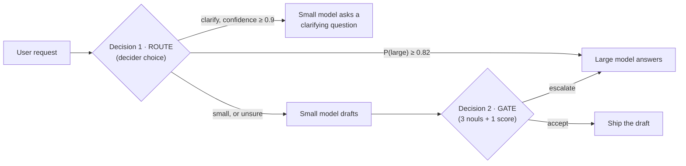
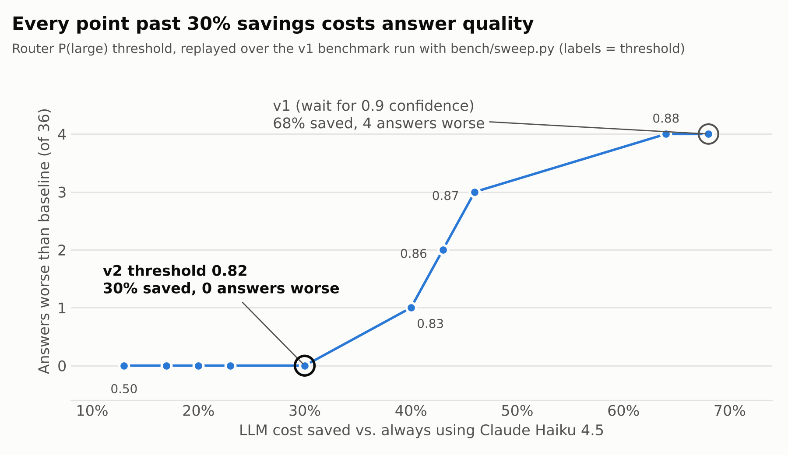

# Escalator

[](https://github.com/Swayam-Ch/escalator/actions/workflows/tests.yml)

**A Strands agent that only pays for a big Bedrock model when Strands Decider 2B says it has to.**

Most questions people ask an assistant are easy. Sending all of them to a frontier model is
like routing every support ticket to your principal engineer. Escalator puts a ~2B decision
model (Strands Decider 2B, running locally, ~100–300 ms per decision) in front of two Bedrock
models and lets it make two calibrated decisions on every turn:



| Decision | Decider question type | Acts when | Otherwise |
| --- | --- | --- | --- |
| **Route**: which tier should answer? | `choice` over `small` / `large` / `clarify` | P(`large`) ≥ 0.82, or `clarify` with confidence ≥ 0.9 | cheap draft, then gate |
| **Gate**: is the small model's draft good enough? | `noul` × 3 (answers fully? hedging? high stakes?) + `score` (4-level rubric) | every check passes | escalate to the large model |

The model **classifies**, the code **decides**: each verdict is a number your `if` statements
branch on, so the policy is auditable and tunable, and the agent can't argue its way past it.
The default is safe: when the router is unsure, the cheap draft still has to pass the gate.

## The reusable decision pattern: *confidence-gated cascade*

[`escalator/patterns.py`](escalator/patterns.py) is self-contained (standard library only, no
Strands or Bedrock imports). Use it in any agent:

```python
from escalator.decider import Decider
from escalator.patterns import TierRouter, AdequacyGate, GatePolicy

decider = Decider()                                  # http://127.0.0.1:8099
route = TierRouter(decider, large_at=0.82).route(prompt)  # Verdict(action="small"|"large"|"clarify", ...)
if route.action == "small":
    draft = my_cheap_llm(prompt)
    verdict = AdequacyGate(decider, GatePolicy(min_quality=2.0)).check(prompt, draft)
    answer = draft if verdict.action == "accept" else my_expensive_llm(prompt)
```

[`examples/minimal_cascade.py`](examples/minimal_cascade.py) runs the pattern with plain Python
functions standing in for the two LLMs: no Strands, no Bedrock, no AWS account, just the decider.

Every `Verdict` carries `action`, a human-readable `reason`, the raw `signals` it branched on,
and the decider's `latency_ms`, which makes logging and threshold-tuning straightforward.

**Why it works with Decider 2B specifically:** the decider's confidences are calibrated (on
unseen short classification tasks, answers at ≥ 0.9 confidence are right ~95% of the time,
per the [strands-decider evaluation](https://github.com/strands-labs/strands-decider/blob/main/evaluation/results.md)).
An LLM's self-reported confidence gives you no such guarantee. Each decision is also a single
forward pass, with no generation and no API bill, so it can sit on the hot path of every request.

**Knobs** (all in code): `TierRouter.large_at` and `TierRouter.sure`, plus `GatePolicy.min_answers`, `max_hedging`,
`max_high_stakes` and `min_quality`. Raise them to escalate more often (higher quality);
lower them to save more. `python bench/sweep.py <results.jsonl>` replays a saved benchmark
run at every router threshold, without new LLM calls, so you can choose `large_at` from data.

## Quick start

Requirements: Python 3.10+, AWS credentials with Bedrock access to the two models (default
`us.amazon.nova-micro-v1:0` and `us.anthropic.claude-sonnet-4-5-20250929-v1:0`, enable them in
the Bedrock console), and a machine that can run the 2B decider (CPU works; Apple silicon or a
GPU is faster).

```bash
git clone <this repo> && cd escalator
python -m venv .venv && source .venv/bin/activate
pip install -e ".[decider,dev]"
cp .env.example .env   # then edit; export the variables or use your AWS profile

# terminal 1: the decision model (downloads ~4 GB from Hugging Face on first run)
strands-decider serve StrandsAgents/strands-decider-2B-qwen3.5-v1-2610 --port 8099

# terminal 2: the agent
escalator                                   # interactive
escalator "What is the capital of Australia?"
```

Example trace (illustrative numbers; yours will differ):

```
decider route  -> small  (P(large) 0.28 < 0.82; small drafts, gate checks)  {...} 1800ms
decider gate   -> accept (draft is good enough)  {'answers': 0.93, 'hedging': 0.04, 'high_stakes': 0.16, 'quality': 2.3} 2000ms
  nova-micro-v1: 21+12 tok, $0.000002, 410ms

[nova-micro-v1] Canberra.
```

## Benchmark: measure the savings

```bash
python bench/run_bench.py            # cost + latency vs. always-large baseline (36 questions)
python bench/run_bench.py --judge    # + the large model grades every answer the small model shipped
python bench/run_bench.py --judge --questions bench/holdout.jsonl   # 24 questions never used for tuning
python bench/sweep.py bench/reported/v1-haiku-results.jsonl         # replay a run at every threshold
```

The set in [`bench/questions.jsonl`](bench/questions.jsonl) mixes easy, hard, ambiguous and
high-stakes requests. Results go to `bench/results/<timestamp>/summary.md`: total cost, median
and p95 latency, decider overhead, where each kind of question was routed, and (with `--judge`)
how many shipped small-model answers matched the large model's quality.

### Results

Nova Micro as the small model, Claude Haiku 4.5 as the large model and as the judge, with the
decider on an Apple-silicon MacBook (MPS). Full outputs are in [`bench/reported/`](bench/reported/).

| | v1: route on a confident pick (≥ 0.9) | v2: route on P(large) ≥ 0.82 |
| --- | ---: | ---: |
| LLM cost vs. always-Haiku | **−68%** | **−20%** |
| Small-model answers judged as good as Haiku's | 18 / 22 | **15 / 15** |
| Answers worse than the baseline | 4 | **0** |
| Easy questions answered by Nova Micro | 12 / 14 | 12 / 14 (**99% cheaper** on those 12) |
| Vague questions answered with a clarifying question | 3 / 4 | 3 / 4 |
| Decider time per question, median | 5.1 s | 3.8 s |

**What v1 taught us.** All four v1 failures were code, SQL, schema design or a compound-interest
calculation that the gate let through. The gate's scores couldn't tell those drafts apart from
correct ones (every draft scored "answers" ≈ 0.90–0.95), because a 2B classifier can't check
code or maths. But the router's P(large) separated easy requests (0.17–0.47) from hard ones
(0.76–0.90). v1 ignored that signal because it waited for a 0.9-confidence pick that never came.
`bench/sweep.py` replayed v1 at every threshold, which showed the trade-off below; v2 uses 0.82.



| P(large) threshold | Saving | Answers worse than baseline |
| ---: | ---: | ---: |
| 0.90 | 68% | 4 |
| 0.86 | 43% | 2 |
| 0.83 | 40% | 1 |
| 0.81 | 30% | 0 |

**Read these numbers with care.**
- The saving comes from questions the small model can handle, and this set is half hard or
  high-stakes on purpose. A traffic mix with more easy questions would save more.
- The 0.82 threshold was chosen on the same 36 questions it was then tested on.
- Haiku grades its own reference answers.
- Laptop latency is not the decider's best case. Its published median is about 115 ms per
  question on an RTX 3090.

Prices live in [`escalator/pricing.py`](escalator/pricing.py). Check them against the
[Bedrock pricing page](https://aws.amazon.com/bedrock/pricing/) before you publish numbers.

## Tests

```bash
pytest -q
```

The tests use a fake decider and fake models, so they need neither AWS nor the model.

## Project layout

```
escalator/patterns.py   the reusable decision pattern (router + gate + policy)
escalator/decider.py    tiny urllib client for `strands-decider serve`
escalator/agent.py      the cascade, built on Strands Agents + BedrockModel
escalator/pricing.py    Bedrock prices for cost accounting
escalator/cli.py        interactive demo with a decision trace
bench/                  benchmark + held-out questions, runner, threshold sweep, saved results
examples/               the pattern with no Strands or Bedrock
docs/                   article draft, demo video script, trade-off chart, submission checklist
```

## Limitations

- Decider 2B is an experimental model, not a production product. The questions and thresholds
  here were chosen by hand; tune them on your own traffic using the benchmark.
- Single-turn questions only. Each request goes to a fresh agent.
- An escalated request pays for the small draft *and* the large answer, so savings depend on
  your mix of easy and hard traffic. The benchmark shows the break-even for your own mix.

MIT licensed. `#strands-decider-2b`
